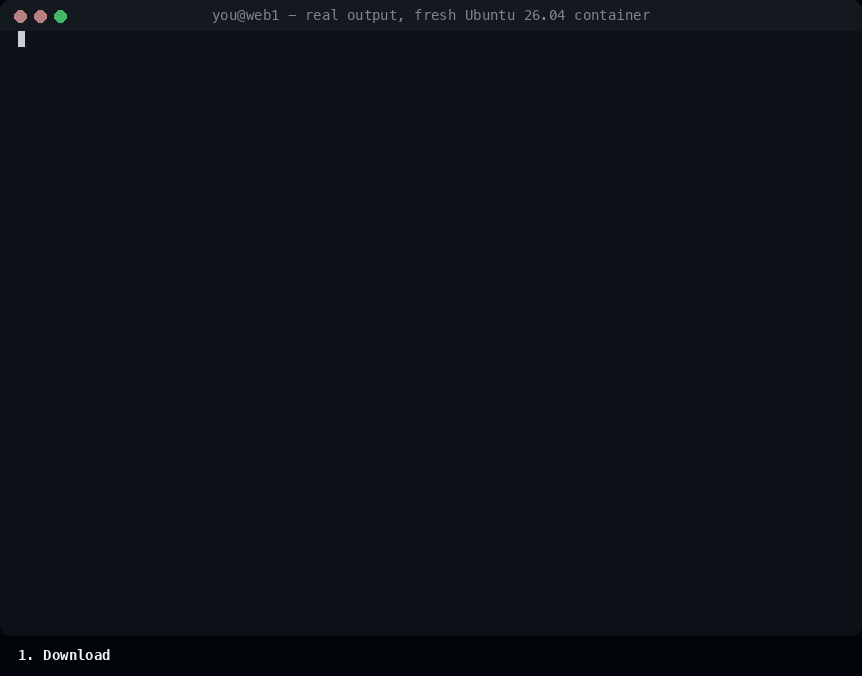

# php-security-watch (en español)

**Un vigilante de seguridad que revisa cada noche cualquier servidor Linux que corre PHP.** Es un solo
archivo, sin dependencias aparte de Python 3. Se instala en un minuto y te dice en palabras simples qué
necesita tu atención, antes de que otro lo encuentre.

[English](README.md) · Esta página resume lo esencial; la referencia completa (todas las opciones,
el formato JSON, las preguntas frecuentes) está en el [README en inglés](README.md).



<sub>Salida real en un contenedor nuevo de Ubuntu 26.04; la revisión nocturna va acelerada.</sub>

---

## Por qué usarlo

Tener un servidor PHP seguro es vigilar muchas cosas, y las herramientas de siempre ven solo un pedazo:

- **El actualizador del sistema** (`unattended-upgrades`, `dnf-automatic`) parcha los paquetes del
  sistema. Nunca mira las librerías de tus sitios, ni un PHP o un Node.js copiado a mano en `/opt`.
- **`composer audit` y `npm audit`** revisan un proyecto, cuando alguien se acuerda de correrlos. Las
  copias de prueba y las versiones viejas nunca se revisan.
- **Las plataformas de seguridad completas** necesitan agentes, un servidor central y tiempo para
  instalarlas y ajustarlas.

php-security-watch revisa todo el servidor en una sola corrida cada noche:

- **Ve lo que el actualizador no ve.** En su primera corrida en nuestro propio servidor, apt decía «no
  hay actualizaciones de seguridad» mientras un Node.js instalado a mano no tenía un parche de seguridad
  y una app de Python traía un certifi con certificados raíz comprometidos.
- **Primero lo que los atacantes usan hoy.** Una falla de la lista de CISA de fallas explotadas
  activamente que toca tu software sale como crítica.
- **Cada hallazgo dice qué hacer**, en una línea simple.
- **Nunca inventa un «todo bien».** Si una fuente no responde, o responde a medias, el informe lo dice.
- **Callado por defecto.** Un solo mensaje cuando hay algo nuevo, algo se arregló o algo empeoró, más un
  resumen semanal.
- **Seguro por defecto.** Solo lee. El modo fix instala solo parches de seguridad, prueba cada
  configuración antes de reiniciar y nunca reinicia el servidor.
- **Sin registrarte en nada.** Gratis (MIT), un solo archivo, solo la librería estándar de Python, sin
  telemetría, sin cuentas y sin servicios nuestros en el medio.

## Qué revisa

Cada noche mira todo el servidor, no solo PHP:

- **Sistema operativo:** si tu versión todavía recibe parches de seguridad.
- **Parches pendientes:** actualizaciones de seguridad esperando en apt, dnf, yum, apk o zypper, y si
  las actualizaciones automáticas están encendidas.
- **Reinicios:** si falta reiniciar (kernel nuevo) y qué servicios siguen usando librerías viejas.
- **Cada PHP del servidor** (el del sistema, Remi, cPanel EasyApache, Plesk, DirectAdmin, `/usr/local`,
  contenedores Docker): su versión contra la última versión de seguridad de su rama, fin de soporte y
  ajustes riesgosos de `php.ini`.
- **Servicios expuestos:** PHP-FPM, MySQL/MariaDB, PostgreSQL, Redis, Memcached, Elasticsearch o
  MongoDB escuchando en una dirección pública, y los puertos que publica Docker.
- **Node.js y Python:** versiones sin parches o fuera de soporte.
- **Librerías de tus sitios:** `composer.lock`, `package-lock.json`, `yarn.lock`, `pnpm-lock.yaml`,
  `poetry.lock`, `Pipfile.lock`, `requirements.txt`, virtualenvs y `Gemfile.lock` contra Packagist y OSV.
- **WordPress:** versión, archivos del núcleo cambiados o agregados, plugins cerrados en wordpress.org.
- **Noticias:** fallas que CISA marca como **explotadas activamente** y que tocan software de tu
  servidor, versiones de seguridad nuevas de PHP, paquetes de Ubuntu con CVE altos abiertos.
- **Intrusión:** firmas de web shells en archivos PHP, PHP dentro de carpetas de subidas, programas
  corriendo desde `/tmp`, procesos raros o de minería, crontabs y llaves SSH de los usuarios web,
  caídas de PHP-FPM.
- **Sitios:** que cada sitio de nginx / Apache / Caddy responda, que el certificado no esté por vencer,
  y que no estén expuestos `.env`, `.git`, `phpinfo()` ni el `eval-stdin.php` de phpunit.

Cada hallazgo tiene un nivel (**critical**, **warning**, **fixed** o **info**) y una línea de «qué
hacer». Si una revisión no logra llegar a su fuente, lo dice; nunca reporta un falso «todo bien».

Por defecto **solo lee y reporta**. Si querés, también puede instalar los parches de seguridad y
reiniciar los servicios afectados, probando cada configuración antes y revisando después que los
sitios sigan respondiendo.

## Instalar

Necesitás un servidor Linux, acceso root y Python 3.6 o más nuevo (ya viene en Ubuntu, Debian,
RHEL/Rocky/Alma, Fedora, Alpine y openSUSE actuales; `--deps` lo instala si falta).

```sh
curl -fsSL https://github.com/Zoaftware/php-security-watch/archive/refs/tags/v1.0.0.tar.gz | tar xz
cd php-security-watch-1.0.0
sudo ./install.sh --email vos@ejemplo.com
```

O con git:

```sh
git clone https://github.com/Zoaftware/php-security-watch.git
cd php-security-watch
sudo ./install.sh --email vos@ejemplo.com
```

Listo. Corre todas las noches a las 03:00 (hora del servidor) y te escribe cuando algo necesita atención.

### Opciones de instalación

| Opción | Qué hace | Por defecto |
|---|---|---|
| `--email vos@ejemplo.com` | A dónde mandar los avisos (separados por coma si son varios) | ninguno |
| `--webhook URL` | Slack, Discord, Telegram, ntfy o cualquier webhook que reciba JSON | ninguno |
| `--smtp-url smtps://host:465` | Enviar por un servidor SMTP en vez del `sendmail` local | sendmail local |
| `--mode report\|fix` | `report` solo mira; `fix` también instala parches de seguridad | `report` |
| `--time 03:00` | A qué hora corre cada día | `03:00` |
| `--timezone America/Costa_Rica` | Zona horaria de `--time` | la del servidor |
| `--no-timer` | Instalar sin programarlo (lo corrés vos o desde tu propio programador) | |
| `--run-now` | Hacer la primera revisión apenas termina de instalar | |
| `--deps` | Instalar antes `python3`, `ca-certificates` y `ss` con tu gestor de paquetes | |

Ejemplos:

```sh
# Avisos por Slack, a las 02:30 hora de Costa Rica, y revisar ya mismo
sudo ./install.sh --webhook https://hooks.slack.com/services/T000/B000/XXXX --time 02:30 --timezone America/Costa_Rica --run-now

# Correo por Gmail / Google Workspace / cualquier proveedor (la contraseña va después en el archivo de configuración)
sudo ./install.sh --email vos@ejemplo.com --smtp-url smtps://smtp.gmail.com:465

# Automático: instala parches de seguridad y recarga PHP-FPM y el servidor web
sudo ./install.sh --email vos@ejemplo.com --mode fix
```

El instalador:

1. copia el programa a `/usr/local/sbin/php-security-watch`;
2. escribe `/etc/php-security-watch.conf` (solo root, `0600`) **solo la primera vez**; si ya existe, lo
   conserva y deja el ejemplo nuevo al lado como `php-security-watch.conf.new`;
3. crea `/var/lib/php-security-watch` para los informes;
4. lo programa con un **timer de systemd**, o con `/etc/cron.d` donde no hay systemd, o con
   `/etc/crontabs/root` en Alpine.

Correr `install.sh` otra vez es seguro: actualiza el programa y conserva tu configuración.

## Primera corrida

```sh
sudo php-security-watch test-notify       # confirma que el correo o el webhook te llega
sudo php-security-watch run --no-notify   # primera revisión completa (lee cada archivo PHP)
sudo php-security-watch status            # último resultado y cuándo es la próxima corrida
```

La primera corrida y la del resumen semanal leen todos los archivos PHP buscando web shells. Las demás
noches solo leen los archivos que cambiaron en los últimos `INTRUSION_DAYS` días. `run --deep` obliga la
lectura completa.

Cuánto dura depende de cuántos archivos tenga el servidor. Medido en un servidor de 4 GB con 35 sitios y
sus copias de versiones: la primera corrida tardó 584 s y una corrida normal que leyó 628.901 archivos
PHP cambiados tardó 580 s, las dos con prioridad baja y con los sitios atendiendo normal.

## Avisos

Poné `NOTIFY_EMAIL`, `WEBHOOK_URL` o los dos en `/etc/php-security-watch.conf` y probá con
`sudo php-security-watch test-notify`.

Con `NOTIFY_WHEN=new` (por defecto) te escribe solo cuando hay algo nuevo, algo se arregló, un aviso se
volvió crítico, o es el día del resumen semanal (lunes). Un aviso que sigue abierto se repite cada
`REMIND_DAYS` días (7). Sin novedades, no hay mensaje.

```ini
NOTIFY_EMAIL=vos@ejemplo.com, equipo@ejemplo.com
SMTP_URL=smtps://smtp.ejemplo.com:465
SMTP_USER=avisos@ejemplo.com
SMTP_PASSWORD_FILE=/root/.smtp-password      # un archivo solo de root con la contraseña sola
MAIL_FROM=avisos@ejemplo.com
```

| Servicio | `WEBHOOK_URL` |
|---|---|
| Slack | `https://hooks.slack.com/services/...` |
| Discord | `https://discord.com/api/webhooks/...` |
| Telegram | `https://api.telegram.org/bot<TOKEN>/sendMessage?chat_id=<CHAT_ID>` |
| ntfy (aviso al teléfono) | `https://ntfy.sh/<tu-tema-secreto>` |
| Cualquier otro | una URL que acepte un `POST` JSON: recibe el informe completo |

## Modo fix

`MODE=report` nunca cambia nada en el servidor. `MODE=fix` (o `run --apply` para una sola corrida)
además instala **solo los parches de seguridad** y reinicia los servicios que siguen con código viejo,
según `RESTART_SERVICES` (`none`, `php-fpm`, `web` o `all-safe`). Antes de cada reinicio prueba la
configuración y, si la prueba falla, no reinicia. Después revisa que el servicio y los sitios sigan
arriba. **Nunca reinicia el servidor.**

## Desinstalar

Desde la carpeta donde lo instalaste (o una descarga nueva de la misma versión):

```sh
sudo ./uninstall.sh            # quita el programa y su horario, conserva tu configuración e informes
sudo ./uninstall.sh --purge    # además borra /etc/php-security-watch.conf y /var/lib/php-security-watch
```

Quita solo lo que creó `install.sh`. Los parches de seguridad que instaló en modo fix se quedan: esos
son los arreglos.

¿Perdiste la carpeta? Esto hace lo mismo a mano:

```sh
sudo systemctl disable --now php-security-watch.timer
sudo rm -f /etc/systemd/system/php-security-watch.timer /etc/systemd/system/php-security-watch.service
sudo systemctl daemon-reload
sudo rm -f /etc/cron.d/php-security-watch /usr/local/sbin/php-security-watch
sudo sed -i '/# php-security-watch/d' /etc/crontabs/root 2>/dev/null   # solo Alpine
sudo rm -rf /etc/php-security-watch.conf /var/lib/php-security-watch   # solo si también querés borrar los datos
```

## Actualizar

Descargá la versión nueva y corré su instalador; tu configuración se conserva. Si hay ajustes nuevos,
aparecen en `/etc/php-security-watch.conf.new` para que los compares con los tuyos.

## Privacidad

Para comparar versiones consulta APIs públicas por HTTPS (packagist.org, api.osv.dev, php.net,
nodejs.org, endoflife.date, api.wordpress.org, la lista KEV de CISA, ubuntu.com). Solo envía nombres y
versiones de paquetes. Sin telemetría, sin cuentas y sin servicios nuestros. Los informes quedan en
`/var/lib/php-security-watch`, legibles solo por root.

## Licencia

MIT. Reportes de seguridad: ver [SECURITY.md](SECURITY.md).
